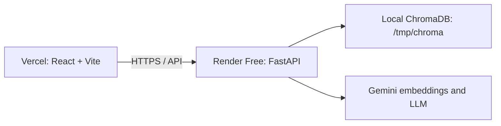

# RepoSage

RepoSage is an AI-powered legacy codebase intelligence and architecture copilot. It indexes a repository's source structure, Abstract Syntax Trees (AST), dependency graph relationships, and recent Git archaeological history so developers can understand architectural decisions, trace technical flows, and get grounded code citations.

---

## Key Features

### 🛠️ Guided Change Assistant ("Where do I add X?")
- **Task-Oriented Intelligence**: Automatically detects questions about adding, creating, or implementing features (e.g. *"Where do I add a new endpoint?", "How do I implement audit logging?"*).
- **Template-Grounded Checklists**: Rather than returning generic prose, RepoSage uses file-profile semantic routing and dependency graph traversal to locate an analogous existing feature in the codebase (e.g. router $\rightarrow$ service $\rightarrow$ frontend UI).
- **Ordered Implementation Plan**: Produces an ordered, numbered checklist of exact files to touch, grounded strictly in the codebase's existing architectural patterns without hallucinating absent modules.

### 🎯 Granular Answer Confidence Levels
- **Visible Quality Signals**: Every answer surfaces a calibrated confidence badge:
  - 🟢 **High Confidence**: $\ge 3$ retrieved code chunks match with similarity $\ge 0.80$ ($\text{cosine distance} \le 0.20$).
  - 🟡 **Medium Confidence**: 1–2 matches present, or matches present with similarity below the high cutoff.
  - 🔴 **Low Confidence**: Zero code matches, or signature evidence missing in indexed AST, or offline fallback threshold unmet.
- **Pre-Stream Availability**: Confidence signals are computed and transmitted in the initial `"meta"` SSE stream event before tokens begin arriving.

### 💬 Persistent, Shareable Conversation History
- **Stateful Threads**: Conversations survive page refreshes and can be shared across team members via URL query parameters (`?conversation={id}`).
- **One-Click Link Sharing**: Built-in "Copy share link" button in the chat header with clipboard feedback.
- **Session Conversation History**: Thread messages, citations, and confidence metadata are retained in a bounded in-memory cache for the active service session.
- **Defensive UUID Validation**: Endpoints validate that conversation identifiers are well-formed UUIDs, preventing injection into cache keys.

### ⚡ Incremental Indexing & Caching
- **Per-File Hash Delta Detection**: Automatically tracks SHA-256 hashes of indexed files. On re-indexing, only added, modified, or deleted files are parsed and embedded, avoiding full vector store wipes.
- **Configurable Cache Tiers**:
  - **Tier 1 (Exact Match)**: Fast in-memory exact query retrieval.
  - **Tier 2 (optional)**: ChromaDB semantic answer cache using cosine similarity ($\ge 88\%$ threshold for direct matches, $\ge 80\%$ threshold for offline fallback). It is disabled on Render Free via `SEMANTIC_CACHE=off`.

### 🛡️ Resilient Embeddings
- Cloud embedding via Google Gemini API with automatic exponential retry.
- Optional thread-safe local ONNX fallback (`all-MiniLM-L6-v2`) when `SEMANTIC_CACHE=on`; Render Free defaults to deterministic hash-vector fallback to stay within its memory budget.

### 🌊 Real-Time SSE Token Streaming
- Chat answers stream in real-time token-by-token over Server-Sent Events (`/api/chat-stream`), accompanied by early metadata emissions for referenced code lines and Git archaeology commits.

---

## Getting Started

### Live Demo

- Frontend: `https://YOUR-VERCEL-PROJECT.vercel.app`
- API: `https://YOUR-RENDER-SERVICE.onrender.com`



### Known limitations on the free tier

- Render Free services sleep after inactivity and cold-start on the next request.
- `/tmp/chroma`, cloned repositories, uploaded folders, cache entries, and conversation history are ephemeral; they reset when the Space restarts.
- A small public sample repository is indexed in the background after an empty-space restart, so the demo may take a short time before its first results are ready.
- Browser uploads and large repository indexing are limited by free CPU, memory, and request duration.

---

### Local Development (without Docker)

#### 1. Backend Setup
```bash
cd backend
python -m venv .venv
.\.venv\Scripts\activate      # Windows (or source .venv/bin/activate on Unix)
pip install -r requirements.txt
uvicorn main:app --reload --port 7860
```

#### 2. Frontend Setup
```bash
cd frontend
npm install
npm run dev
```
Open `http://localhost:5173` to access the development UI.

Set `VITE_API_URL=http://localhost:7860` in `frontend/.env.local` when running
the frontend outside the Vite proxy. Do not commit `.env.local`.

---

## Reliability & Trust Calibration

- **Deterministic Indexing**: Indexes up to 2,000 source files (2 MB per file). Open the **Index coverage report** in the UI to inspect every parsed file, skipped file reasons, excluded directories, and parser fallbacks.
- **AST Parsing with Regex Fallback**: Python and JS/TS/TSX are parsed into AST function and class symbols using Tree-sitter, falling back to regex extraction when Tree-sitter binaries are not available.
- **Refusal Discipline**: If a question asks for function parameters or signatures but AST structural evidence is not retrieved, RepoSage explicitly reports that it cannot confirm signatures rather than fabricating implementations.
- **Zero Hallucination Absence**: Absence of code in retrieved chunks is never stated as proof that a component is absent from the repository.

---

## Analyzing Local Folders on Windows

A Docker container cannot access arbitrary Windows directories without an explicit mount. Specify a parent root in `.env`:
```env
HOST_REPO_ROOT=C:/Users/your-username/Projects
```
Then submit any folder path underneath that root in the UI. For hosted deployments, use the **Upload folder** button in the browser (filters `node_modules` and binary artifacts automatically before uploading).
